<p align="center">
  
</p>

<h1 align="center">Artha AI</h1>

<p align="center"><b>Bas ishaara kaafi hai.</b> A hint is enough.</p>

<p align="center">
  Artha AI turns Indian voice notes into the right actions. You speak the way you speak to family: in Hinglish, Marathi, Telugu, Tamil, Urdu, Punjabi, Bengali or English, with half-names and no dates. Artha works out <i>who</i>, <i>when</i> and <i>how much</i> from your own life, and gets the message, call, payment or reminder ready.
</p>

<p align="center">
  <a href="https://heyartha.web.app"><b>Open the live app</b></a> ·
  <a href="https://heyartha.web.app/?app">Install it on your phone</a> ·
  OpenAI × Equal AI BUILDERS 2026, Track 2: Voice AI for India
</p>

<p align="center">
  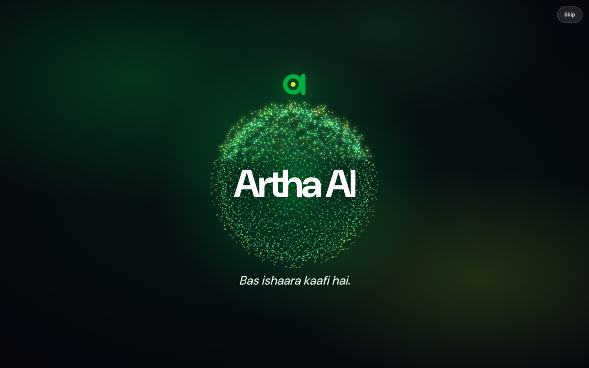
</p>

---

## Contents

- [The problem](#the-problem)
- [What Artha does](#what-artha-does)
- [A tour of the app](#a-tour-of-the-app)
- [What people said, and what Artha did](#what-people-said-and-what-artha-did)
- [Results](#results)
- [How it works](#how-it-works)
- [Memory and embeddings](#memory-and-embeddings)
- [Tech stack](#tech-stack)
- [API](#api)
- [Privacy and safety](#privacy-and-safety)
- [Run it locally](#run-it-locally)
- [Deploy](#deploy)
- [Repo layout](#repo-layout)

---

## The problem

958 million Indians were online in 2025, and 98% of internet users use it in Indian languages (IAMAI–Kantar, *Internet in India* 2025 and 2024). They speak more than they type, and they speak in hints:

> **"Mehta ji wala appointment parso shaam ko shift karwa do."**
> *Move the Mehta ji appointment to the day after tomorrow, evening.*

Which Mehta: the doctor or the neighbour? Which day is "parso"? What time is "shaam"? Is this a call or a message? A general model hears the words correctly and still gets the action wrong, because the meaning lives in the speaker's life, not in the sentence. With the same transcription, a base model completed **19.5%** of these notes correctly. Artha completes **97.6%**.

Equal already made India's phone calls understandable. Artha AI does the same for the short voice notes people send all day.

## What Artha does

- **Hears** a voice note (or typed text) in 9 languages, mixed freely.
- **Knows who you mean.** Two Rahuls, two Mehtas, two Ayushes: it picks the right one from the topic, the people around them and your past messages.
- **Asks when it truly can't tell**, with one short question and a button for each person, in your language.
- **Gets actions ready**, never sends on its own: WhatsApp or SMS messages, calls, UPI payments, reminders, calendar entries and khata (credit ledger) entries.
- **Writes each message in the receiver's language.** Santosh Anna gets Telugu, a son in New Jersey gets English.
- **Answers questions** about your life ("Is mahine kya kya bharna hai?") as a headline plus points, spoken in full, and follows up ("English mein batao" translates the last answer).
- **Reads photos** of a handwritten khata page, checks the maths, and files it.
- **Learns from Gmail** (read-only): a new user signs in with Google and Artha builds their people, plans, bills and payments from 90 days of mail.
- **Never lets an OTP through.** OTPs are caught in code, before any AI model sees them.
- **Installs like an app** from the browser on Android and iPhone, with no app store.

## A tour of the app

### 1. The intro

<table>
<tr>
<td width="50%">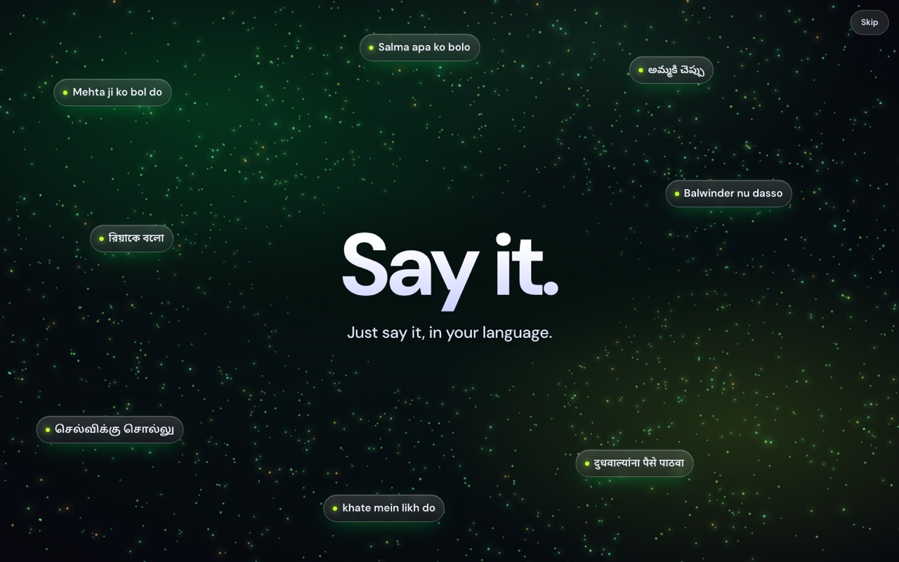</td>
<td width="50%">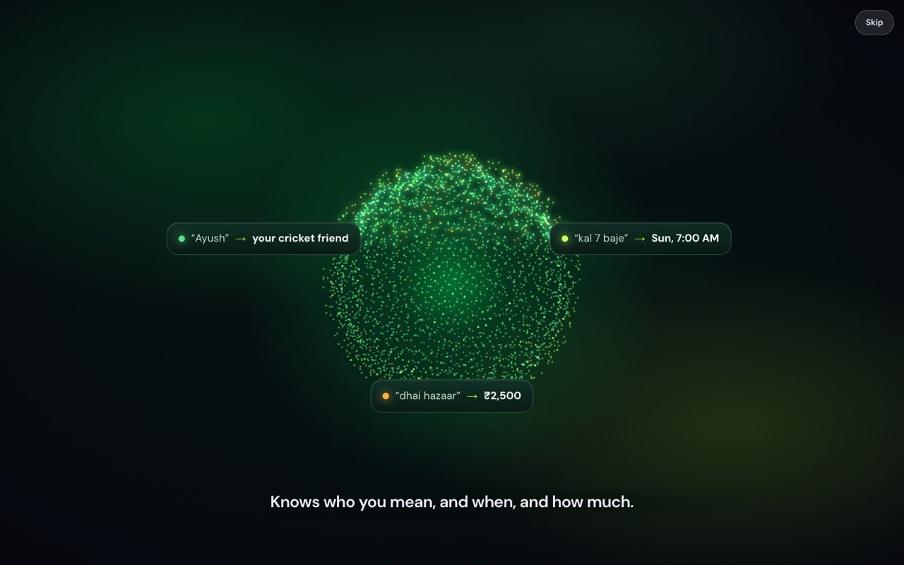</td>
</tr>
<tr>
<td><b>Bolo.</b> A three.js particle orb wakes up as the app opens.</td>
<td><b>Hints become meaning.</b> "Ayush" becomes your cricket friend, "kal 7 baje" becomes Sun 7:00 AM, "dhai hazaar" becomes ₹2,500.</td>
</tr>
</table>

### 2. Sign in, and Artha learns your life

A new user signs in with Google. Artha reads the last 90 days of Gmail (read-only, OTP mails never opened) and the setup road shows each stop as it happens. When the road finishes, it folds away and only the results stay.

<table>
<tr>
<td align="center">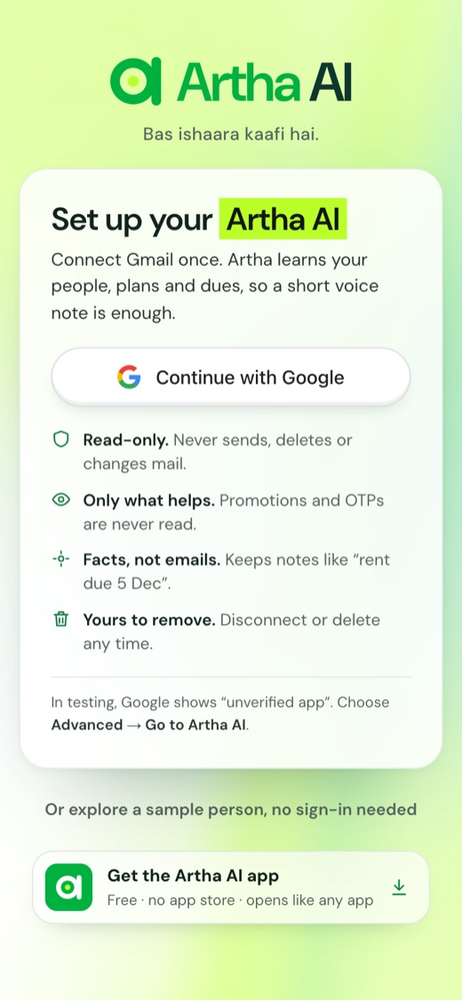</td>
<td align="center">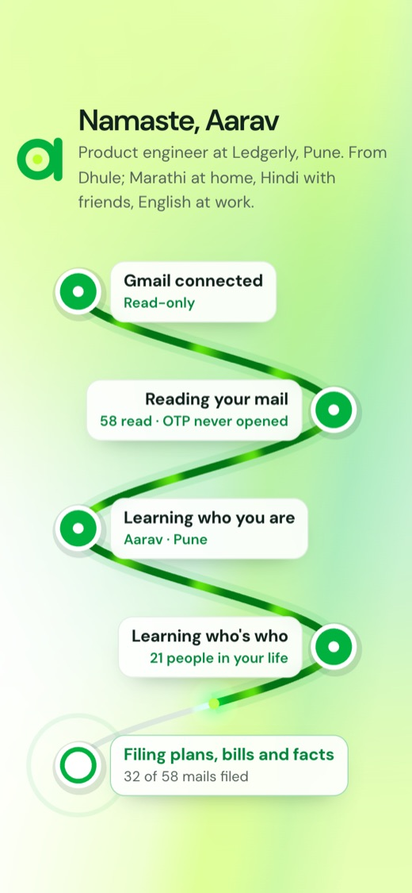</td>
<td align="center">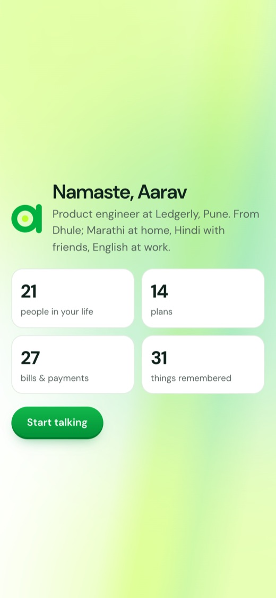</td>
</tr>
<tr>
<td align="center">Sign in</td>
<td align="center">The setup road (three.js + GSAP)</td>
<td align="center">What it learned</td>
</tr>
</table>

<p align="center">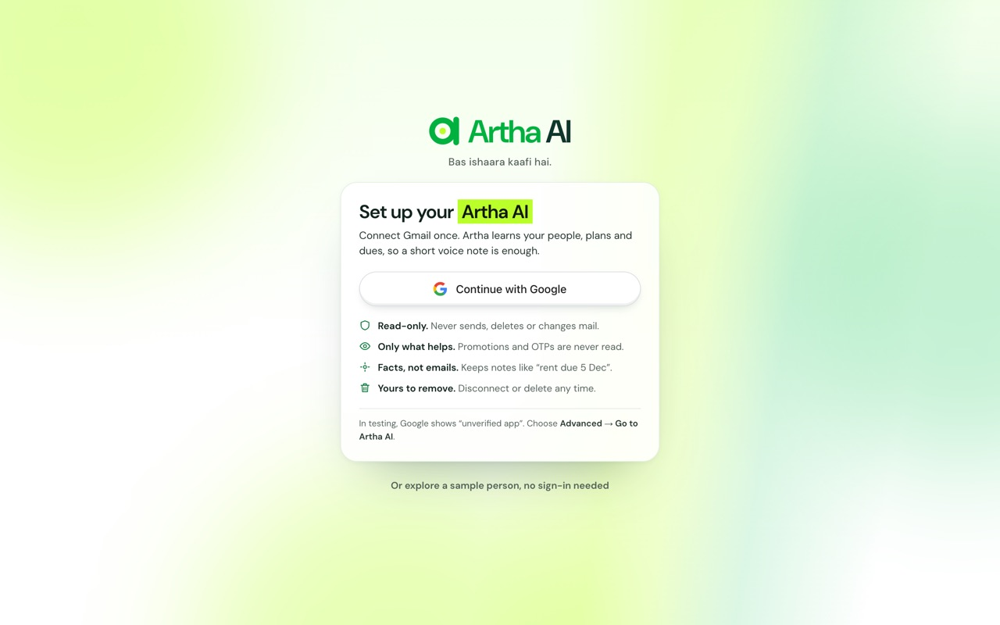</p>

### 3. Speaking to the orb

Tap the orb and talk. While you speak, it listens; while Artha thinks, the "You said" card fills in stage by stage (Heard → Meaning → Who → Plan); then Artha speaks its reply and the action cards appear.

<p align="center">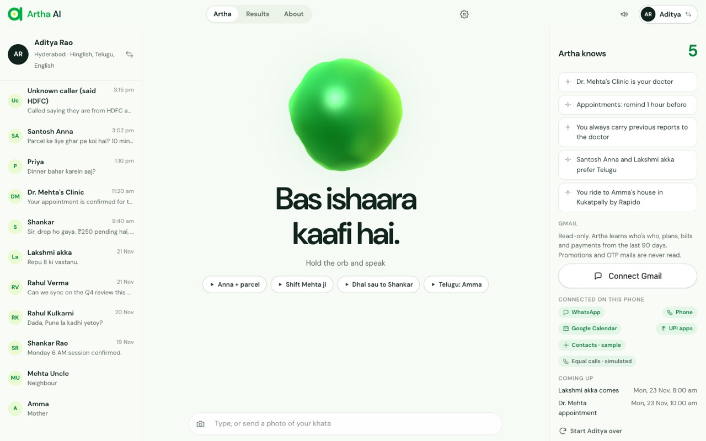</p>

<table>
<tr>
<td width="50%">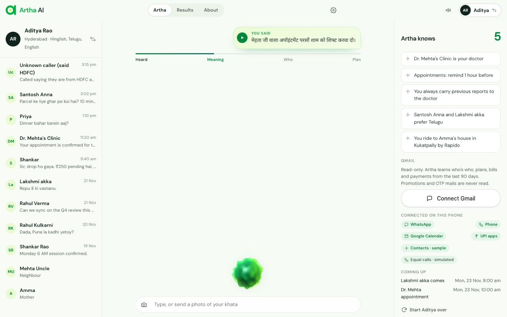</td>
<td width="50%">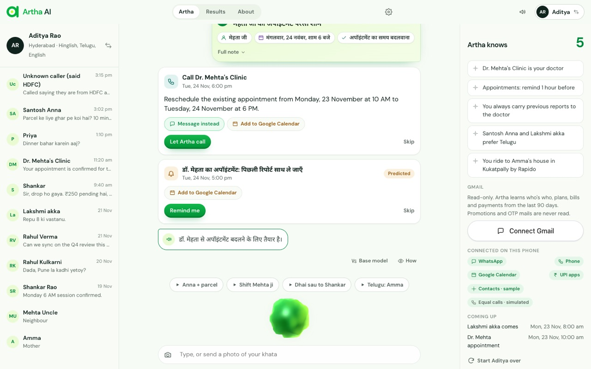</td>
</tr>
<tr>
<td><b>Thinking.</b> Each stage lights up as it finishes.</td>
<td><b>Speaking.</b> The reply plays as it streams, in your language.</td>
</tr>
</table>

<p align="center"></p>

*"Mehta ji wala appointment parso shaam ko shift karwa do."* Artha picks **Dr. Mehta's Clinic** (not Mehta Uncle the neighbour), turns "parso shaam" into **Tue 24 Nov, 6 PM**, offers to call, and predicts a reminder to carry the previous reports because the user always does. The reply it speaks: *"डॉ. मेहता से अपॉइंटमेंट बदलने के लिए तैयार है।"*

### 4. When Artha has a doubt, it asks

<table>
<tr>
<td align="center">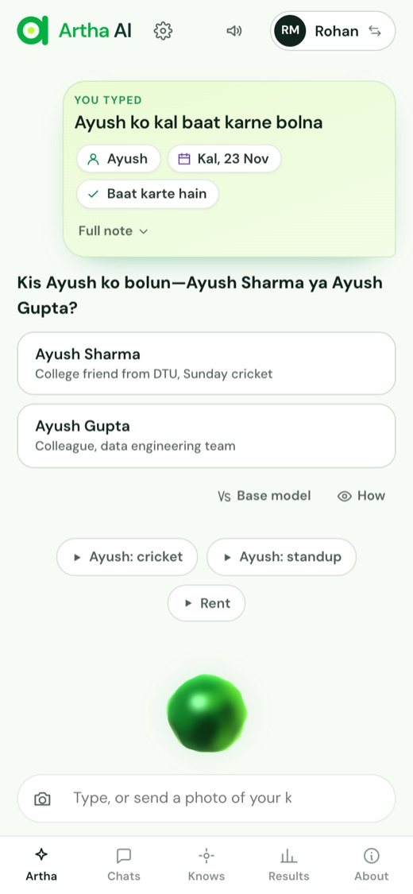</td>
<td align="center">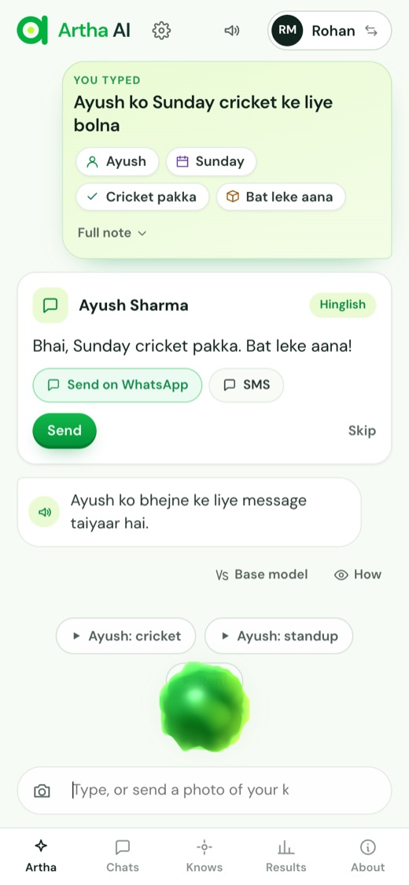</td>
<td align="center">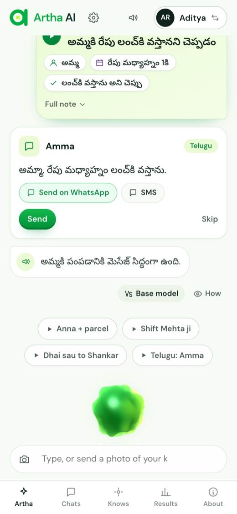</td>
<td align="center">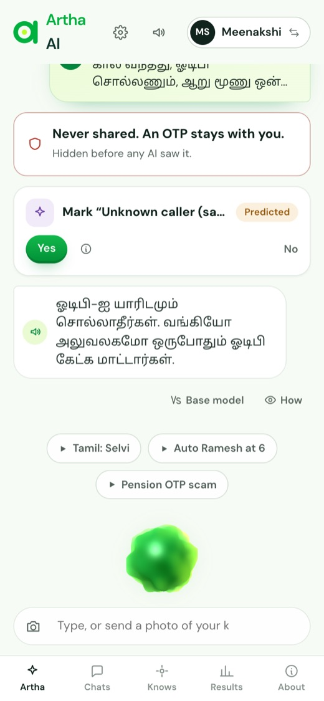</td>
</tr>
<tr>
<td align="center"><b>A true tie:</b> "Ayush ko kal baat karne bolna" asks which Ayush.</td>
<td align="center"><b>A clue decides:</b> "Sunday cricket" means Ayush Sharma, no question.</td>
<td align="center"><b>Telugu</b> in, Telugu message out.</td>
<td align="center"><b>OTP blocked</b> in code, warning in Tamil.</td>
</tr>
</table>

### 5. Photos, memory, settings and install

<table>
<tr>
<td width="50%">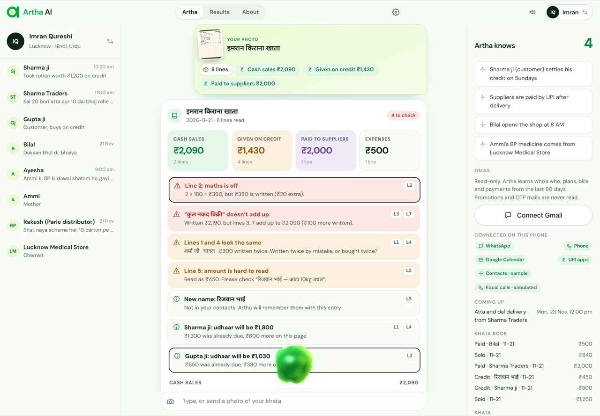</td>
<td width="50%">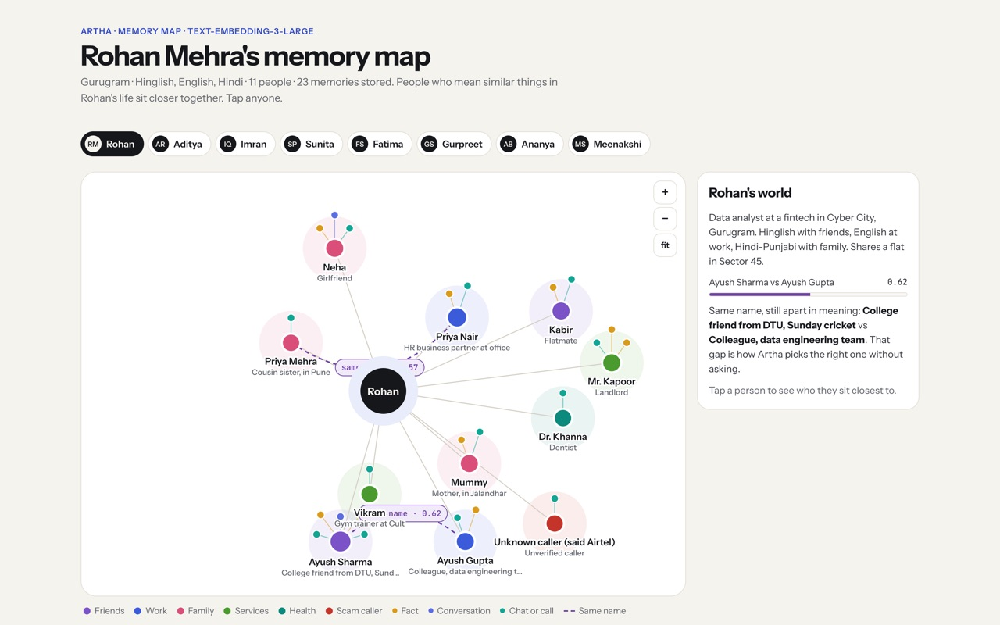</td>
</tr>
<tr>
<td><b>Khata photo.</b> A handwritten page becomes totals, with mistakes flagged ("Line 2: maths is off").</td>
<td><b>Memory map.</b> Each person sits where their meaning puts them. The two Ayushes share a name but sit apart.</td>
</tr>
<tr>
<td>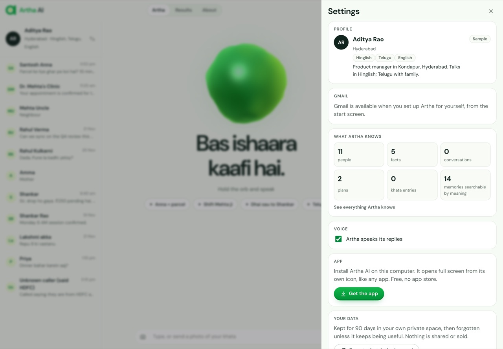</td>
<td>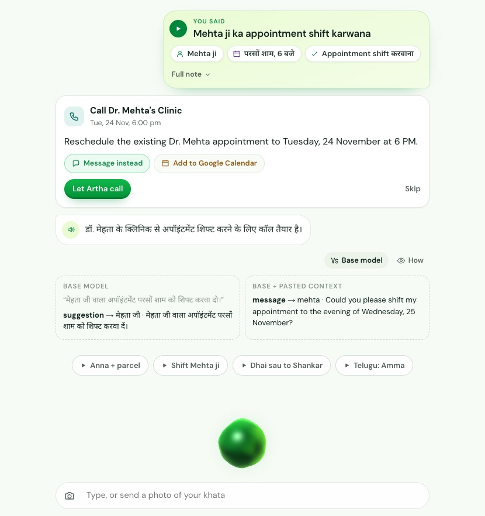</td>
</tr>
<tr>
<td><b>Settings.</b> See what Artha knows, sync or disconnect Gmail, forget or delete everything.</td>
<td><b>Base model vs Artha.</b> Tap "Base model" on any note to compare.</td>
</tr>
</table>

<table>
<tr>
<td align="center">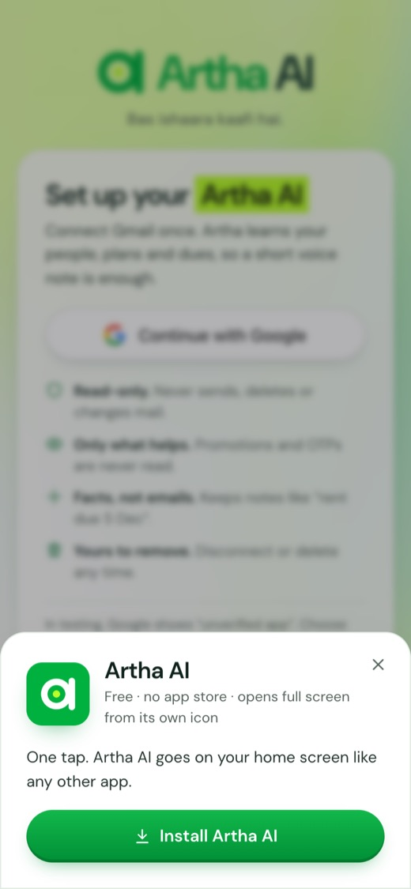</td>
<td align="center"></td>
</tr>
<tr>
<td align="center">Install from the browser</td>
<td align="center">Scan to install</td>
</tr>
</table>

## What people said, and what Artha did

Real runs from the 41-note benchmark ([eval/results.json](eval/results.json)). "Heard" is the transcription by `gpt-transcribe` with name hints. Every note was spoken; play the clips in [docs/artha-story/clips](docs/artha-story/clips).

| | Language | Heard | Meaning | Artha did | Base model did |
|---|---|---|---|---|---|
| 🔊 [a2](docs/artha-story/clips/a2.mp3) | Hinglish | Mehta जी वाला अपॉइंटमेंट परसों शाम को शिफ्ट करवा दो। | Move the Mehta ji appointment to the day after tomorrow, evening. | **Call → Dr. Mehta's Clinic**, Mon 23 Nov 6 PM, + reminder 5 PM | Message → "महता जी" (no such contact) |
| 🔊 [a1](docs/artha-story/clips/a1.mp3) | Hinglish | अन्ना को बोल दो, पार्सल सिक्योरिटी पे छोड़ दे। | Tell Anna to leave the parcel with security. | **Message → Santosh Anna** (in Telugu) | |
| 🔊 [a4](docs/artha-story/clips/a4.mp3) | Hinglish | राहुल को बोल दो, कल की मीटिंग चार बजे रखते हैं। | Tell Rahul we'll keep tomorrow's meeting at four. | **Message → Rahul Verma** (office, not the cousin), tomorrow 4 PM | |
| 🔊 [a6](docs/artha-story/clips/a6.mp3) | Telugu | అమ్మకి చెప్పు రేపు మధ్యాహ్నం లంచ్కి వస్తాను. | Tell Amma I'll come for lunch tomorrow afternoon. | **Message → Amma**, tomorrow 1 PM | Message → "అమ్మ" |
| 🔊 [a7](docs/artha-story/clips/a7.mp3) | Hinglish | HDFC वाले को OTP बता दो, चार आठ दो नौ एक तीन। | Tell the HDFC person the OTP: 4 8 2 9 1 3. | **Blocked in 3 ms**, digits hidden, offer to mark the caller as a scam | |
| 🔊 [s1](docs/artha-story/clips/s1.mp3) | Marathi | पवार डॉक्टरांना सांगा, उद्या सकाळी अकरा वाजता येते. | Tell Dr. Pawar I'll come tomorrow at 11 in the morning. | **Message → Dr. Pawar** (not Pawar the milkman), tomorrow 11 AM | Message → "Pawar doctor" |
| 🔊 [s2](docs/artha-story/clips/s2.mp3) | Marathi | दूध वाल्यांना या महिन्याचे पैसे पाठव. | Send the milkman this month's money. | **UPI → Pawar Dudhwale ₹1,850** (amount from his last message) | |
| 🔊 [s3](docs/artha-story/clips/s3.mp3) | Marathi | मंगल ताईला सांग, उद्या कामाला येऊ नका. | Tell Mangal tai not to come to work tomorrow. | **Message → Mangal tai** | Message → "मंगल ताई" |
| 🔊 [i1](docs/artha-story/clips/i1.mp3) | Hindi | शर्मा जी के खाते में ढाई हजार और लिख दो। | Add another 2,500 to Sharma ji's account. | **Khata → Sharma ji ₹2,500** | Khata → Sharma ji ₹2,500 |
| 🔊 [i2](docs/artha-story/clips/i2.mp3) | Hindi | शर्मा वाले को बोलो, कल आटा चार बजे तक भेज दे। | Tell the Sharma people to send the atta by 4 tomorrow. | **Message → Sharma Traders** (the supplier, not the customer), 4 PM | Message → "शर्मा वाले" |
| 🔊 [m1](docs/artha-story/clips/m1.mp3) | Tamil | செல்விக்கு சொல்லு, நாளைக்கு வர வேண்டாம். | Tell Selvi not to come tomorrow. | **Message → Selvi** (in Tamil) | |
| 🔊 [m2](docs/artha-story/clips/m2.mp3) | Tamil | ஆட்டோ ரமேஷுக்கு சொல்லு, நாளை காலை ஆறு மணிக்கு வாங்க. | Tell Auto Ramesh to come at 6 tomorrow morning. | **Message → Auto Ramesh** (not Dr. Ramesh), 6 AM | |
| 🔊 [m5](docs/artha-story/clips/m5.mp3) | Tamil | பென்ஷன் ஆபீஸ்ல இருந்து கால் வந்தது, ஓடிபி சொல்லணும், ஆறு மூணு ஒன்னு நாலு. | The pension office called, I have to tell the OTP: 6 3 1 4. | **Blocked in 1 ms**, warning in Tamil | |
| | Hinglish | आयुष को बोल दो, कल मैच सात बजे है, बैट ले आना। | Tell Ayush the match is at 7 tomorrow, bring the bat. | **Message → Ayush Sharma** (cricket friend) | Message → "पायुष" |
| | Hinglish | आयुष को बोलो, स्टैंडअप से पहले डैशबोर्ड फिक्स पुश कर दे। | Tell Ayush to push the dashboard fix before standup. | **Message → Ayush Gupta** (colleague) | Message → "आयुष" |
| | Urdu | सलमा को बोलो, जुम्मे को बिरयानी बना रही हूँ, ज़रूर आना। | Tell Salma I'm making biryani on Friday, do come. | **Message → Salma Apa** (sister-in-law, not the bridal customer) | Message → "सलमा" |
| | Punjabi | ਬਲਵਿੰਦਰ ਨੂੰ ਅੱਠ ਹਜ਼ਾਰ ਡੀਜ਼ਲ ਐਡਵਾਂਸ ਭੇਜ ਦਿਓ। | Send Balwinder 8,000 as a diesel advance. | **UPI → Balwinder "Bittu" ₹8,000** (the driver, not Mama ji) | UPI → "ਬਲਵਿੰਦਰ" |
| | Bengali | লক্ষ্মীদিকে বলো, পরশু থেকে এলে চলবে। | Tell Lakshmi-di it's fine if she comes from the day after tomorrow. | **Message → Lakshmi-di** | Message → "লক্ষ্মীদি" |

Benchmark dates are relative to the run on 21 Nov 2026. A blank "Base model" cell means the base model got that note right or partly right; see [eval/results.json](eval/results.json) for every case.

## Results

All numbers come from files in [eval/](eval/): 41 voice notes, 8 people, 9 languages.

| Whole task right (right person, action, time and amount) | |
|---|---|
| Base model (`gpt-6-luna`, same transcript) | 19.5% |
| Base model + the person's profile pasted in | 80.5% |
| **Artha AI** | **97.6%** (40 of 41; the one miss was a timeout, not a wrong answer) |

| Actions | |
|---|---|
| Precision | 100% |
| Recall | 97.4% |
| F1 | 98.7% |

| Speed on the live app (median of 13 spoken clips) | |
|---|---|
| Words heard | 1.30 s |
| "You said" card | 2.71 s |
| Action cards | 3.72 s |
| Voice reply starts | 3.74 s |

| Live end-to-end checks | |
|---|---|
| Benchmark notes on the deployed app | 43 / 43, median 3.65 s, p90 5.21 s |
| Multi-turn persona conversations | 26 / 26 |
| Gmail new-user checks | 24 / 24 |

## How it works

One voice note goes through these steps. Each word is a stage in [server/pipeline](server/pipeline).

**Hear → Guard → Normalize → Candidates → Recall → Plan → Rules → Act → Speak → Remember**

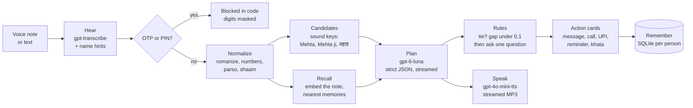

1. **Hear.** `gpt-transcribe` gets the audio plus a hint list of the names in this person's life, so "Mehta ji" and "Santosh Anna" come out right.
2. **Guard.** Secret rules run on the transcript in code. An OTP, PIN or CVV never reaches a model; the digits are masked and the card explains why.
3. **Normalize.** Romanizes Indic scripts, turns spoken numbers ("dhai hazaar", "saadhe aath") into values, and relative days ("parso", "kal", "Jumme") into dates.
4. **Candidates.** Every mention is matched against contacts by sound keys, so "महता", "Mehta ji" and "Mehta Uncle" all find both Mehtas.
5. **Recall.** The note is embedded and compared with the person's stored memories:
   `score = 0.7·cosine + 0.15·same person + 0.15·e^(−age/21 days)`.
6. **Plan.** `gpt-6-luna` (reasoning off, strict JSON schema) gets the note, the candidates and the recalled memories, and writes the plan. Fields stream out, so the "You said" card and the spoken reply start before the plan is finished.
7. **Rules.** Code checks the plan. If two people are a true tie (evidence gap under 0.1), Artha asks one short question in the user's language instead of guessing.
8. **Act.** Actions become cards with WhatsApp, SMS, call, UPI or calendar links. Nothing is sent without a tap.
9. **Speak.** `gpt-4o-mini-tts` (voice "coral") reads the reply, streamed as MP3 into the browser with MediaSource.
10. **Remember.** The turn, the choice the user made, and any correction are stored, so the next note is smarter. Tap ⇄ to fix a wrong pick once; Artha remembers it.

## Memory and embeddings

Each person has one SQLite file (`node:sqlite`), kept on the server's disk. It has 13 tables: `entity`, `alias`, `fact`, `turn`, `action`, `event`, `cal`, `book`, `ledger`, `balance`, `habit`, `vec` and `meta`. Rows expire after 90 days.

Every person and memory has a vector from `text-embedding-3-large`, cut to **256 dimensions** and stored as **int8 plus one float scale**: 260 bytes a row instead of 12 KB.

A real row from Rohan's memory file:

```text
{ kind: "fact", entity: "ayush_s",
  text: "Ayush Sharma is your college friend from DTU; you play cricket with him every Sunday…",
  emb:  Int8[256] = [2, 2, -22, 16, -35, 84, -45, 5, 15, 30, -48, 21, …],
  scale: 0.001596,  bytes: 260 }
```

The two Ayushes share a name, but their meanings are far apart:

| Pair | Cosine |
|---|---|
| Ayush Sharma (college friend, Sunday cricket) vs Ayush Gupta (colleague, payments dashboard) | **0.624** |

Rohan says *"Ayush ko bol Sunday cricket pakka, bat leke aana"*. Recall, with `score = 0.7·meaning + 0.15·same person + 0.15·recency`:

| Score | Memory |
|---|---|
| **0.834** | Ayush Sharma: "Bhai Sunday match pakka? 7 baje Tau Devi Lal. Bat le aana" |
| 0.645 | Fact: Ayush Sharma is your college friend from DTU; you play cricket… |
| 0.597 | Ayush Sharma: "Goa wale ₹1,500 salary aate hi bhejta hoon" |
| 0.570 | Ayush Gupta: "Can you push the payments dashboard fix before standup…" |

"Cricket" and "bat" pull the note to Ayush Sharma, so Artha picks him without asking. *"Ayush ko bol kal baat karte hain"* has no clue: the evidence gap is under 0.1, so Artha asks which Ayush.

## Tech stack

| Layer | What we use |
|---|---|
| Speech to text | OpenAI `gpt-transcribe`, with per-person name hints |
| Understanding | OpenAI `gpt-6-luna` (reasoning off, strict JSON schema, streamed fields); also reads khata photos and Gmail |
| Text to speech | OpenAI `gpt-4o-mini-tts`, voice "coral", streamed MP3 |
| Embeddings | OpenAI `text-embedding-3-large`, 256 dims, int8 |
| Memory | SQLite file per person (`node:sqlite`), 90-day expiry |
| Frontend | React 18, TypeScript, Vite, three.js (orb, intro, setup road), GSAP; installable PWA with a service worker |
| Backend | Node 24 on Render (free plan, Singapore), streamed responses |
| Hosting | Website on Firebase Hosting (heyartha.web.app); a scheduled GitHub ping keeps the API awake |
| CI/CD | GitHub Actions: typecheck, tests, build on every PR; Render redeploys the API from `main` |
| Gmail | Google OAuth, read-only scope; tokens encrypted with AES-256-GCM |

## API

All routes are under `/api`. The app uses the streamed `/api/note`; the others serve the UI, settings and tests. Code: [server/handler.ts](server/handler.ts).

| Route | What it does |
|---|---|
| `POST /note` | The whole pipeline for one note (audio or text), streamed as events: heard, stages, say, audio, actions |
| `POST /transcribe` | Stage 1 only: audio to text with name hints |
| `POST /understand` | Stages 2–5 on a transcript: meaning, who, plan, rules |
| `POST /scan` | Read a photo (khata page, bill), check it and file it |
| `POST /answer` | The user picked a person after "which one?"; remembered for next time |
| `POST /act` | Carry out an action inside the app and learn from it |
| `POST /skip` | The user skipped a card |
| `GET /speak`, `POST /speak` | Spoken reply (streamed, or whole file) |
| `GET /state`, `GET /persona`, `GET /personas` | What the UI needs to draw a person |
| `GET /context` | The memory space: what Artha holds, how big, what expires when (memory map) |
| `GET /auth/google` | Sign up with Google: builds a new user from their mail |
| `GET /gmail/connect`, `GET /gmail/callback`, `GET /gmail/status`, `POST /gmail/sync`, `POST /gmail/disconnect` | Read-only Gmail; sync is streamed so the setup road can show progress |
| `POST /profile`, `POST /me/forget`, `POST /me/delete` | Settings: edit profile, forget what was learned, delete the account |
| `POST /reset` | Start a sample person over |
| `GET /results`, `GET /health` | Benchmark results and models in use |

## Sample people

The app ships with eight fictional people, each with a same-name trap. Pick one from your name in the top right → Sample people.

| Person | City | Speaks | The trap |
|---|---|---|---|
| Aditya Rao | Hyderabad | Hinglish, Telugu | Two Rahuls, two Shankars, two Mehtas |
| Sunita Patil | Pune | Marathi | Two "tai"s, two Pawars (doctor, milkman) |
| Imran Qureshi | Lucknow | Hindi, Urdu | Sharma ji (customer) vs Sharma Traders (supplier) |
| Meenakshi Sundaram | Chennai | Tamil, English | Dr. Ramesh vs Auto Ramesh, plus scam calls |
| Rohan Mehra | Gurugram | Hinglish, English | Two Ayushes, two Priyas |
| Fatima Sheikh | Hyderabad | Urdu, Hindi | Salma Begum (customer) vs Salma Apa (family) |
| Gurpreet Singh | Ludhiana | Punjabi, Hindi | Balwinder "Bittu" (driver) vs Balwinder Mama ji |
| Ananya Bose | Kolkata | Bengali, English | Riya Sen (colleague) vs Riya Chatterjee (carpool) |

A ninth user, **Aarav Deshmukh**, has no sample data at all. He is built only by signing in with Google on a demo inbox of 62 fictional mails ([data/mock-mail](data/mock-mail)).

## Privacy and safety

- **OTPs never reach a model.** They are caught by rules in code, masked, and the caller can be marked as a scam.
- **Nothing is sent on its own.** Every message, call and payment waits for the user's tap.
- **Gmail is read-only.** Promotions and OTP mails are skipped; tokens are encrypted (AES-256-GCM).
- **Forget or delete anytime** from Settings. Disconnecting Gmail removes everything learned from it.
- **Memories expire** after 90 days.
- All people, numbers and mails in this repo are fictional.

## Run it locally

Needs Node 24 (for `node:sqlite`).

```bash
npm install
cp .env.example .env      # add your keys, see below
npm run dev               # API on :8787, web on Vite
```

| Variable | Needed for |
|---|---|
| `OPENAI_API_KEY` | Everything (speech, plan, voice, embeddings) |
| `GOOGLE_CLIENT_ID`, `GOOGLE_CLIENT_SECRET` | Google sign-in and Gmail (optional) |
| `ARTHA_TOKEN_KEY` | Encrypting Gmail tokens |
| `ARTHA_PUBLIC_URL` | OAuth callback URL when not on localhost |
| `ARTHA_APP_URL`, `ARTHA_ALLOWED_ORIGINS` | Hosted only: the website's address (Google sign-in returns there) and which sites may call the API |
| `ARTHA_STT_MODEL`, `ARTHA_PLAN_MODEL`, `ARTHA_PLAN_EFFORT` | Override the default models |

Other scripts:

```bash
npm test             # pipeline and streaming tests
npm run typecheck
npm run eval         # the 41-note benchmark → eval/results.json
npm run build        # web build
```

## Deploy

- **API:** [Render](https://render.com), free plan, from [render.yaml](render.yaml). Every merge to `main` redeploys it. The OpenAI key is set in Render, never in the repo. Address: https://artha-api-mlqj.onrender.com
- **Website:** Firebase Hosting on the free Spark plan, at **https://heyartha.web.app**. Deploy with `npm run deploy:web`, which builds the app to call the Render API.
- **Checks:** every PR runs typecheck, tests and build ([.github/workflows/deploy.yml](.github/workflows/deploy.yml)). [keepalive.yml](.github/workflows/keepalive.yml) pings the API every 10 minutes so the free server stays awake.
- `infra/` holds the earlier AWS (Lambda + CloudFront) setup, kept for reference.

## Repo layout

```text
web/            React app: orb, intro, setup road, chats, cards, settings, install sheet
  public/       icons, manifest, service worker
server/
  handler.ts    all /api routes and the streamed note pipeline
  openai.ts     speech, plan, voice and embedding calls
  pipeline/     normalize, candidates, rules, understand (plan), scan (photos)
  context/      per-person SQLite memory and embeddings
  connectors/   Gmail (read-only)
data/
  personas/     the eight sample people
  mock-mail/    the demo inbox for the new user
eval/           benchmark cases, clips and results
scripts/        eval, live tests, persona tests, capture, build
tests/          unit tests
infra/          deploy script
docs/           screenshots, brand, memory map, story page
film/           the demo film pipeline (script → voice → frames → video)
```

---

<p align="center">
  <br>
  <b>Artha AI</b> · Bas ishaara kaafi hai.
</p>
